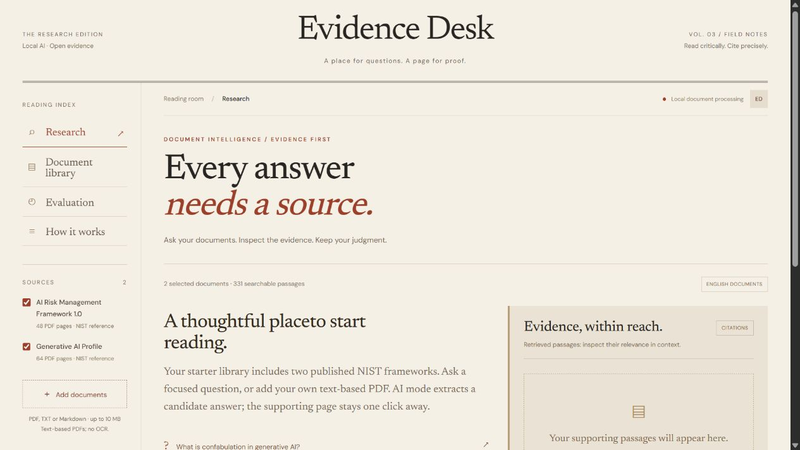
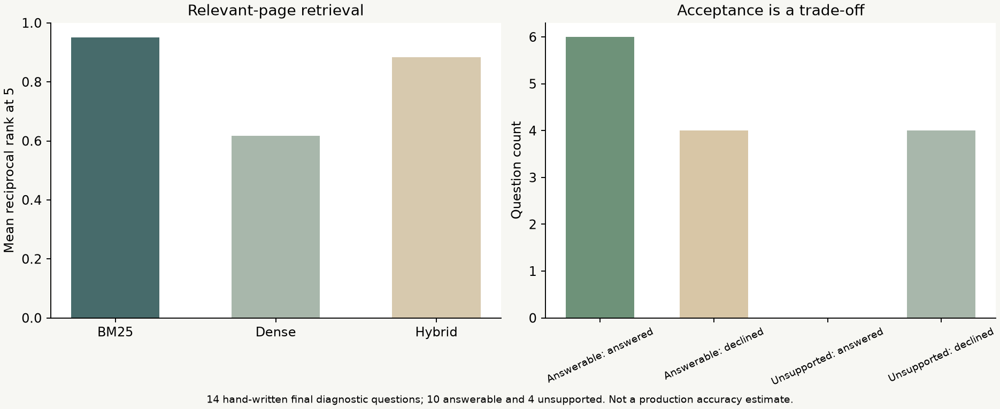

# Evidence Desk

[](https://github.com/Boody700/evidence-desk/actions/workflows/checks.yml)

**Browser-local document QA with PDF uploads, cited source spans and retrieval evaluation.**

[Case study](docs/case-study.md) · [Interview notes](docs/interview-guide.md) · [Validation workflow](.github/workflows/checks.yml)

A browser-local document research assistant with pretrained extractive AI, physical-page citations, document uploads and an evaluated retrieval pipeline.

This project demonstrates AI application engineering rather than a generic chat interface. It includes PDF parsing, page-bound chunking, keyword and neural retrieval baselines, quantized ONNX model inference, abstention, exact source-span alignment, a worker-based application and explicit failure analysis.

## What it does

- Ask focused questions about selected documents.
- Extract a candidate answer from a retrieved passage and open its source page with the answer highlighted.
- Upload text-based PDF, TXT or Markdown files, processed in the browser session.
- Choose **Extractive AI** or an instant, model-free **Evidence search** mode.
- Select documents, inspect pages, remove uploads and export plain-text research notes.
- Inspect a benchmark that separates retrieval quality, answer quality and abstention.

Answers are extracted source spans, not freely generated summaries. A quotation can still answer the wrong question. The app calls them **candidates** and keeps evidence inspection central.



## Starter library

Two specific NIST publications: **AI Risk Management Framework 1.0** (January 2023) and **Generative AI Profile** (July 2024). Together they contain 112 PDF pages and produce 331 chunks using 160 words with 30-word overlap. Chunks never cross physical PDF page boundaries.

These are published-version reference documents, not a claim to provide current regulatory guidance. Original PDFs and citation links are available in the app. File checksums are recorded in `data/source-manifest.json`.

## Measured results

The final diagnostic set contains ten answerable and four unsupported questions. It is small and hand-written; these figures are not production accuracy estimates.

| Final diagnostic measure | Result |
|---|---:|
| Selected retrieval | BM25 keyword-first |
| Relevant page in top 1 | 90% of answerable questions |
| Relevant page in top 3 | 100% of answerable questions |
| Mean reciprocal rank at 5 | 0.950 |
| Answer token F1, including declined answerable questions | 58.9% |
| Exact-match answers | 50% of answerable questions |
| Unsupported questions declined | 4 / 4 |
| Answerable questions declined | 4 / 10 |
| Accepted answers | 6 / 14 total questions |
| Verbatim source containment | 100% of accepted spans |

**Containment is not correctness.** It verifies that an answer occurs in its cited passage, not that it answers the question correctly.

The first 28-question run exposed weak hybrid retrieval and a flawed cross-passage confidence selection policy. That initial result remains in `reports/initial-diagnostic.json`. Fourteen development questions selected the final retrieval strategy and gates. The original test questions are now labeled diagnostic. A fresh 14-question final set was scored afterwards, then rerun after a deterministic tokenizer-to-source span-alignment bug fix; final-test outcomes were not used to tune retrieval or gate thresholds. This history and its limits are visible in the application.



## Run locally

Use **Node.js 22.3+**; the validated build used Node 24.22.1.

```powershell
npm ci --ignore-scripts
npm run build
npm start
```

Open `http://127.0.0.1:4175`. Run `npm run build` before serving to generate the local AI worker from the pinned dependencies. `--ignore-scripts` avoids optional native-runtime installer downloads; packaged CPU inference was verified with this setup.

First AI use downloads approximately 89 MB of public model weights from Hugging Face, plus a browser-specific WASM runtime from jsDelivr. The runtime URL is pinned to the exact lockfile-installed ONNX Runtime version. Model/runtime files may be cached by the browser. Document text and questions are not sent to a remote inference API. Use Evidence search for immediate keyword retrieval without AI weights.

## Reproduce the corpus and benchmark

```powershell
npm ci --ignore-scripts
npm run prepare-data
npm run evaluate
npm run build
npm test
npm start
```

The corpus preparation downloads the two public PDFs if absent, extracts page text with PDF.js, chunks it and computes MiniLM embeddings. Evaluation downloads the quantized answer model, compares retrieval baselines, selects gates using development questions and generates the report. Model downloads use pinned repository revisions. ONNX SHA-256 hashes are checked against `data/model-revisions.json`.

The original PDFs, Node dependencies and local model cache are not committed. Reproduction requires network access to NIST and Hugging Face on the first run, sufficient disk space, and a supported native ONNX runtime platform.

Allow at least 1 GB of free disk space for dependency installation, model caching and build artifacts. Package installers may include binaries for multiple platforms.

## Model choices

- **Encoder:** `Xenova/all-MiniLM-L6-v2`, q8 ONNX, mean pooling, L2 normalization, 384 dimensions.
- **Reader:** `Xenova/distilbert-base-cased-distilled-squad`, q8 ONNX, extractive question answering.
- **Runtime:** Transformers.js 4.3.2 and ONNX Runtime; browser work runs in an ES-module worker.
- **Retrieval baselines:** BM25, dense cosine similarity and reciprocal-rank fusion.
- **Selected operating policy:** development MRR selected lexical retrieval. Neural cosine similarity ≥0.40 and extraction score ≥0.20 gate a candidate from the top-ranked passage.

Those gates are not calibrated probabilities of correctness. No model was fine-tuned on the benchmark. The source-span alignment stage handles tokenizer-inserted punctuation spacing while returning an exact source substring.

## Upload and privacy contract

Maximum 10 MB, 120 PDF pages and 180 passages per upload; six documents and 700 passages per session. TXT/Markdown files are limited to 200,000 characters and use form-feed-delimited sections rather than fabricated page numbers. Scanned PDFs need OCR elsewhere; encrypted PDFs are unsupported.

Uploaded files, parsed text and history stay in session memory. The app uses no document database, localStorage or remote document-processing endpoint. Removing an upload removes its chunks and related answers. Reloading removes uploads and history. Browser model caches can persist independently of documents.

## Project structure

```text
dist/app.mjs              Research UI, local file handling and citations
dist/retrieval.mjs        Chunking, BM25, cosine/RRF, gating and span alignment
src/ai-worker.mjs         Browser model inference and index operations
scripts/models.mjs       Pinned native model loader for reproducibility
scripts/prepare.mjs      PDF download, page extraction and corpus embeddings
scripts/evaluate.mjs     Development selection and diagnostic evaluation
scripts/build.mjs        Worker bundle, PDF.js and pinned runtime configuration
scripts/serve.mjs         Loopback-only static server
data/                    Benchmarks, policy, source and model manifests
reports/                 Full evaluation, initial diagnostic and screenshots
tests/                   Core invariants, real-corpus checks and upload fixture
docs/                    Case study, model/data card, validation, interview guide
```

The runtime CDN avoids the static host's 25 MiB per-file limit; one required WASM variant exceeds it slightly. `data/runtime-manifest.json` records the exact package version and base URL. PDF.js and the app bundle remain local static assets.

## Limitations and attribution

English, text-based documents are the intended scope. Long tables, complex layouts, ambiguous questions, multi-page answers, multiple entities and domain shifts can reduce quality. Browser memory and model-download availability vary. The current system is extractive, not a generative LLM assistant.

See [case study](docs/case-study.md), [model and data card](docs/model-data-card.md), [validation](docs/validation.md) and [interview guide](docs/interview-guide.md). Project code is MIT licensed. NIST publications retain their own notices; Transformers.js, ONNX Runtime, PDF.js and model licenses/attribution are listed in `THIRD_PARTY_NOTICES.md`.

The complete prebuilt application runs locally using the commands above.


## Development

Independent, AI-assisted educational portfolio project. The source, evaluation design and limitations are documented so the work can be inspected and reproduced. GitHub Actions runs the committed browser checks. Python pipeline reproduction uses the commands and data sources described above.
