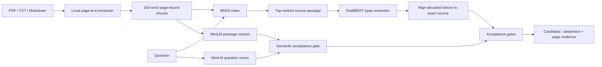

# Architecture

The diagram shows the selected operating policy. Dense and RRF retrieval are evaluated baselines; they do not silently replace the development-selected BM25 strategy.

## Main thread

The application owns document selection, source-page viewing, question history and local file parsing. Uploaded PDFs are passed to PDF.js; only extracted text and page identifiers enter the index. Original PDF uploads use temporary blob URLs for optional local viewing. User-supplied text and names are escaped before presentation.

## Worker

The module worker owns the search index and the pretrained encoder/reader instances. Its messages are `init`, `index`, `remove` and `ask`, with request IDs and progress/error replies. Model weights are lazily loaded. Cancellation terminates the worker, rejects outstanding tasks and reconstructs the index from completed session data.

Evidence search runs BM25 without model inference. AI mode computes missing document embeddings when necessary, encodes the question, retrieves the selected context and extracts a span. Uncalibrated reader scores cannot reorder source pages.

## Network and storage boundaries

- Same-origin static assets: UI, worker bundle, PDF.js, prebuilt public corpus and evaluation report.
- Public artifact requests: pinned model files from Hugging Face and version-pinned ONNX runtime files from jsDelivr.
- No document-processing server or remote inference API.
- No uploaded document or history persistence in localStorage or a database.
- Browser model/HTTP caches may persist independently of document session memory.

The browser runtime is loaded from a pinned public CDN to satisfy the static host's per-file limit. A build-time manifest records its version and URL, and a test enforces the local asset-size budget. See Cloudflare's [static asset limits](https://developers.cloudflare.com/workers/platform/limits/).

## Reproduction and deployment

The lockfile pins JavaScript dependencies. Source/model manifests record original documents, model revisions and ONNX hashes. `prepare.mjs` builds the corpus, `evaluate.mjs` produces diagnostic results, and `build.mjs` packages the browser worker and PDF parser. Only `dist/` is hosted; raw PDFs, local model cache, Node dependencies and authoring files are excluded from deployment.
